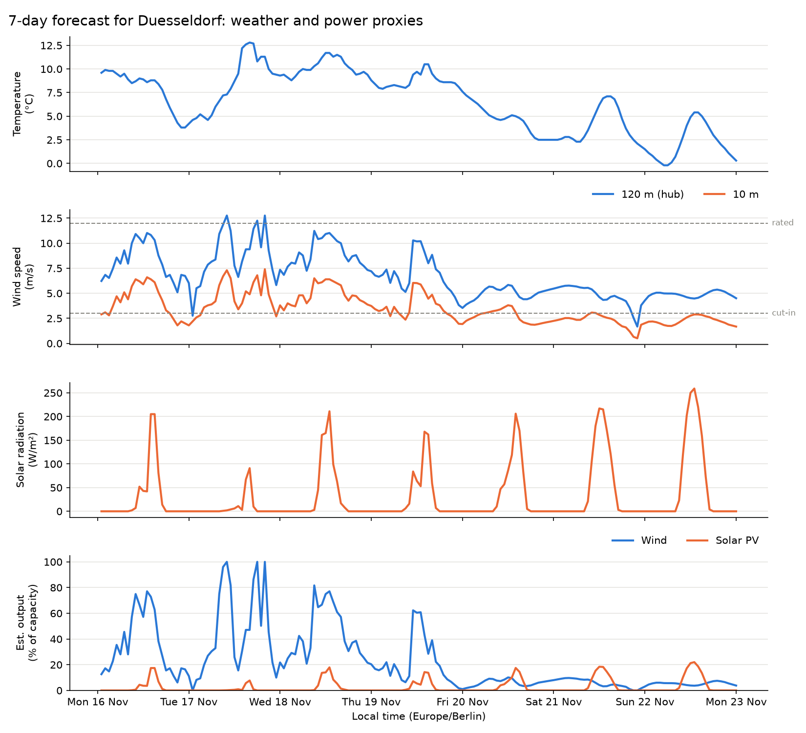

# 7-day weather forecast → wind & solar power proxies

A small Python project that fetches a 7-day hourly weather forecast for a German
location, converts the timestamps from UTC to German local time, and estimates how
much wind and solar power that weather would produce.



## Why

Wind and solar output is the biggest driver of short-term power prices in Germany.
Windy, sunny hours bring cheap supply; calm, dark hours ("Dunkelflaute") push prices up.
A weather-based generation estimate is therefore a natural first input for price
forecasting and for deciding when a battery should charge or discharge.

## What it does

1. **Fetch** an hourly forecast from [Open-Meteo](https://open-meteo.com/) (free, no API key):
   temperature at 2 m, wind speed at 10 m and 120 m (≈ turbine hub height), and solar irradiance.
2. **Convert timestamps**: the API returns Unix seconds in UTC; pandas turns them into
   timezone-aware `Europe/Berlin` timestamps, so daylight saving time is handled
   correctly (23/25-hour days in March/October).
3. **Model output**
   * Wind: simplified power curve (cut-in 3 m/s, rated 12 m/s, cut-out 25 m/s, cubic in between).
     If 120 m wind is missing, it is extrapolated from 10 m with the power law.
   * Solar: irradiance / 1000 W/m² × performance ratio 0.85.
4. **Output**: a 4-panel plot, an hourly CSV and a daily summary per local delivery day.

## Run it

```bash
pip install -r requirements.txt

python weather_forecast.py                 # Düsseldorf, live API
python weather_forecast.py --city husum    # windy North Sea coast
python weather_forecast.py --offline       # use data/sample_response.json
```

If the API cannot be reached, the script falls back to the last saved response, so the
demo always works. Results go to `output/`.

The notebook `weather_forecast.ipynb` walks through the same steps with explanations,
including a small DST example.

## Project structure

```
weather_forecast.py        all logic: fetch, convert, model, plot
weather_forecast.ipynb     step-by-step walkthrough
data/sample_response.json  saved API response for offline runs
output/                    plot + CSV
```

## Limitations and next steps

* A single location is not "Germany": weight several locations by installed wind/PV capacity.
* Generic power curve: no wake losses, curtailment, icing or turbine-specific curves.
* `shortwave_radiation` is the average of the preceding hour; the PV model ignores panel tilt and temperature.
* Next step: validate against actual generation (SMARD / ENTSO-E), then regress EPEX day-ahead
  prices on forecast wind + solar + load.
